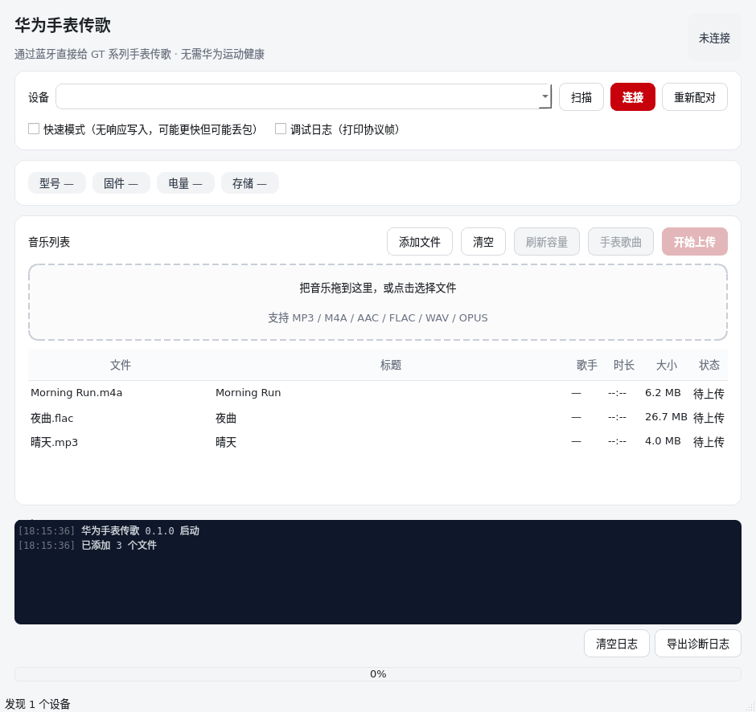

# 华为手表传歌（HuaweiMusic）

在 Windows 上通过蓝牙直接给华为 GT 系列手表上传音乐，**不需要华为运动健康，不需要 root / 越狱，也不需要 Android 手机**。

协议实现逐字节对齐开源项目 [Gadgetbridge](https://codeberg.org/Freeyourgadget/Gadgetbridge)（AGPL-3.0）和它的 iOS 移植 [HuaSideload](https://github.com/Burak4Arslan/huawei-watch-sideload-ios)（AGPL-3.0，已实测 GT 3 SE 可传歌）。



> 非官方工具。与华为公司无关，使用风险自负。

## 功能

- 扫描并连接附近的手表，首次配对后在本地记住密钥（下次一键连接）
- 拖拽或选择多个音频文件，逐个上传，显示实时进度
- 显示手表型号、固件、电量、剩余空间、已存歌曲数
- 查看手表上已有的歌曲列表（标题 / 歌手 / 文件名）
- 中文界面，单文件 exe，双击即用
- 内置诊断日志，一键导出，方便反馈问题

## 支持的手表

| 系列 | 情况 |
| --- | --- |
| **GT 2 / GT 3 / GT 4 / GT 5 / GT Runner** | 主要目标（lite wearable 协议，Gadgetbridge 已完整支持） |
| Watch 3 / 4 / 5 | 协议大体相同，可尝试；部分机型音乐服务有差异 |
| Fit 系列 | 多数没有音乐存储，无法传歌 |
| 其他华为/荣耀手环 | 未验证 |

手表需要先在华为运动健康里完成初始化和配对（语言、地区、条款），之后本工具可以独立连接。

## 使用方法

1. **打开 Windows 蓝牙**，让手表保持在附近。
2. **在手机上断开手表**：打开华为运动健康 → 设备 → 断开连接（或在手机蓝牙设置里取消与手表的连接）。手机占着连接时，电脑连不上。
3. 双击 `HuaweiMusic.exe`。
4. 点「扫描」，在列表中选择你的手表，点「连接」。
   - 第一次连接会自动配对。**手表上可能弹出确认提示，请点“确认/允许”。**
   - 配对过程约 5–30 秒，日志里会显示进度。
5. 把 `mp3 / m4a / aac / flac / wav / opus` 文件拖进窗口（或点「添加文件」）。
6. 点「开始上传」，等待完成。上传速度受 BLE 限制，通常每秒几十到一百多 KB。
7. 传完后在手表上打开「音乐」即可看到歌曲。若列表没刷新，重启手表音乐应用。

下次使用只需：扫描 → 连接 → 拖歌 → 上传。配对密钥保存在 `%APPDATA%\HuaweiMusic\settings.json`。

## 常见问题

**扫描不到手表**
- 确认 Windows 蓝牙已打开，手表在 1–2 米内。
- 手表必须与手机断开（华为运动健康会一直占用连接）。
- 关闭再打开一次 Windows 蓝牙；必要时重启手表。
- 点「扫描」后等待 8 秒，列表里没有就再扫一次。

**连接超时 / 一直卡在“正在连接”**
- 90% 是手机还连着手表。先在手机上断开。
- 手表刚重启或刚断开手机时，等 10 秒再连。
- 在界面勾选「调试日志」后重试，导出日志可以看到卡在哪一步。

**首次配对失败**
- 点「重新配对」，并在手表弹出提示时及时点确认（超时会失败）。
- 如果手表里还保留着旧的配对记录，可在手表「设置 → 蓝牙」里删除电脑，然后重新配对。
- 部分系统需要先在 Windows「设置 → 蓝牙和其他设备」里删除同名设备再试。

**上传很慢 / 中途失败**
- BLE 传歌本身就慢，1 首歌通常需要几十秒到几分钟，属正常。
- 上传时尽量别让手表远离电脑，也别同时用手表听歌。
- 若频繁超时，可尝试勾选「快速模式」（无响应写入，可能更快，但个别适配器会丢包）。

**提示“空间不足 / 文件数已达上限 / 文件已存在”**
- 手表空间或曲目数有限，先在手表上删除一些歌，或换小一点的文件。
- 同名文件会被手表拒绝，改名后再传。

**杀毒软件报警**
- PyInstaller 单文件 exe 偶尔会被误报。可自行从源码打包，或添加信任。

## 从源码运行

需要 Python 3.10+。

```bash
git clone <this repo> hwmusic
cd hwmusic
python -m venv .venv
# Windows
.venv\Scripts\activate
# Linux/macOS
source .venv/bin/activate

pip install -e ".[gui,dev]"
python run_gui.py
```

命令行也可以用来先验证协议：

```bash
hwmusic scan                 # 扫描
hwmusic info                 # 连接并显示设备信息（首次会配对）
hwmusic songs                # 列出手表上的歌曲
hwmusic upload song.mp3      # 上传
hwmusic upload *.flac --debug
```

常用参数：`--address <BLE 地址>`、`--pair`（强制重新配对）、`--fast`、`--debug`。

## 打包 Windows exe

在 Windows 上双击 `packaging\build_windows.bat`，或在命令行：

```bat
python -m pip install -e ".[gui,build]"
python packaging\make_icon.py
pyinstaller packaging\hwmusic.spec --noconfirm --clean
```

产物为 `dist\HuaweiMusic.exe`（单文件，约 60–90 MB）。仓库里的 GitHub Actions 工作流 `.github/workflows/build-windows.yml` 也会在打 tag 或手动触发时自动构建并上传 exe。

## 测试

```bash
python -m pytest -q
```

测试包含一个独立实现的模拟手表（`tests/fake_watch.py`），覆盖帧编解码、CRC、TLV、加密、HiChain 配对、加密上传和歌曲列表，全部在本地完成，不需要硬件。

## 协议

协议摘要见 [docs/PROTOCOL.md](docs/PROTOCOL.md)。

## 致谢与许可

- [Gadgetbridge](https://codeberg.org/Freeyourgadget/Gadgetbridge) — 华为 lite wearable 协议的主要逆向成果（AGPL-3.0）。
- [HuaSideload](https://github.com/Burak4Arslan/huawei-watch-sideload-ios) — Swift 移植与实测验证（AGPL-3.0）。
- 本项目同样以 **AGPL-3.0-or-later** 发布，见 [LICENSE](LICENSE)。

本项目不包含华为的任何专有代码或资源。请只上传你有权使用的音乐。
